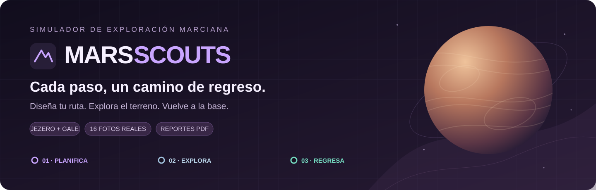
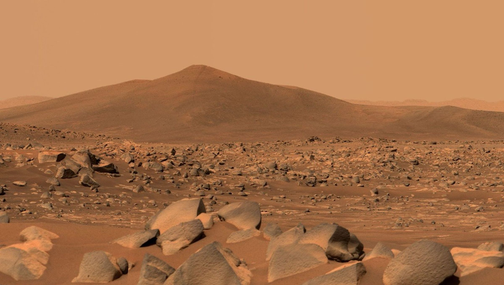
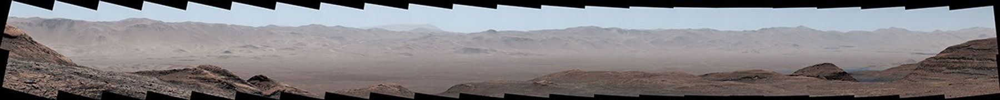
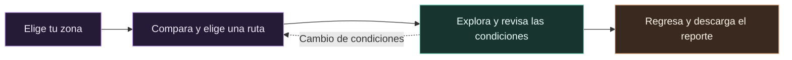

<p align="center">
  
</p>

<p align="center">
  <strong>Una experiencia interactiva para planificar caminatas en Marte y encontrar el camino de regreso.</strong>
</p>

<p align="center">
  <a href="https://mars-scouts-nasa-challenge.vercel.app/"><strong>Abrir la demo</strong></a>
  &nbsp; · &nbsp;
  <a href="#inicio-rápido">Ejecutar en tu equipo</a>
  &nbsp; · &nbsp;
  <a href="#guía-de-uso">Guía de uso</a>
  &nbsp; · &nbsp;
  <a href="docs/TECHNICAL.md">Documentación técnica</a>
</p>

## El proyecto

**Mars Scouts** es una aplicación web de simulación que convierte la exploración marciana en una experiencia de planificación y toma de decisiones. Elige una zona, compara recorridos y acompaña a un astronauta mientras observa el terreno y administra el tiempo de su misión.

Cada plan incluye el regreso a **Ares Base**. Si cambian la movilidad, la carga o la visibilidad, puedes revisar cómo afectan al recorrido y elegir una nueva ruta desde tu posición actual.

| Zonas de exploración | Fotografías reales | Rutas por comparar | Historial de misión |
| :---: | :---: | :---: | :---: |
| **Jezero y Gale** | **16 imágenes distintas** | **Hasta 3 alternativas** | **Descarga en PDF** |

## Dos paisajes, una misión

<table>
  <tr>
    <td width="50%" valign="top">
      
      <p><strong>JEZERO · Perseverance</strong><br />Santa Cruz y el suelo rocoso del cráter.</p>
    </td>
    <td width="50%" valign="top">
      
      <p><strong>GALE · Curiosity</strong><br />Peace Vallis y el borde norte del cráter.</p>
    </td>
  </tr>
</table>

*Fotografías reales utilizadas en las fichas educativas de la app. Créditos: NASA/JPL-Caltech/ASU/MSSS para Jezero y NASA/JPL-Caltech/MSSS para Gale. [Ver fuentes y créditos completos](assets/places/README.md).*

## Una misión en tres pasos

| 01 · Planifica | 02 · Explora | 03 · Regresa |
| --- | --- | --- |
| Elige Jezero o Gale, selecciona tus observaciones y compara las rutas disponibles. | Sigue el recorrido en el mapa, revisa la elevación y responde a cambios de las condiciones. | Consulta el margen de regreso, vuelve a la base y descarga el reporte de tu misión. |



## Qué puedes hacer

| 🗺️ Planificación de rutas | 🧑‍🚀 Seguimiento del explorador | 🛡️ Regreso y orientación |
| --- | --- | --- |
| Compara tiempo, distancia, ascenso y restricciones. Elige entre las opciones viables para tu misión. | Observa la posición, el esfuerzo y las lecturas fisiológicas simuladas durante la caminata. | Recibe indicaciones y alertas de proximidad. Compara regresar ahora con explorar unos minutos más. |

| 🌄 Descubrimiento de lugares | 👥 Perfiles de equipo | 📄 Memoria de la misión |
| --- | --- | --- |
| Consulta fotografías reales, datos educativos y enlaces a sus fuentes. Cada punto tiene su propia imagen. | Cambia entre hasta 12 astronautas locales, cada uno con su recorrido y progreso independientes. | Revisa decisiones, cambios de ruta y eventos. Exporta el historial en un PDF generado en el navegador. |

### Dos escenarios para explorar

| Jezero Crater | Gale Crater |
| --- | --- |
| **El contacto del delta.** Explora un escenario inspirado en el delta occidental y los afloramientos visitados por Perseverance. | **Entre crestas y depresiones.** Explora un escenario inspirado en las formaciones *boxwork* de Mount Sharp estudiadas por Curiosity. |
| Wildcat Ridge · Skinner Ridge · Delta lookout | Valley hollow · Monte Grande ridge · Boxwork lookout |
| Un cambio de movilidad permite revisar el regreso a un ritmo más lento. | Un cierre de acceso permite buscar un recorrido que evite la cresta. |

Las fichas distinguen las fotografías de lugares reales de las referencias visuales utilizadas para puntos simulados. Puedes abrir cada foto original y consultar sus créditos.

## Inicio rápido

**Requisitos:** Node.js **20 o superior** y un navegador web. La app se ejecuta sin dependencias externas de producción ni un paso de compilación.

1. Abre una terminal en la carpeta del proyecto.
2. Inicia el servidor:

   ```powershell
   npm.cmd run dev
   ```

3. Abre **[http://localhost:3000](http://localhost:3000)**.

En Windows también puedes hacer doble clic en **[start.cmd](start.cmd)**. Mantén la terminal abierta mientras usas la app y presiona **Ctrl+C** para detener el servidor.

<details>
<summary>Otras formas de iniciar</summary>

En macOS, Linux o una terminal compatible:

```bash
npm run dev
```

También puedes iniciar directamente con Node.js:

```bash
node server.mjs
```

Abre la dirección HTTP indicada por el servidor para que los módulos de JavaScript se carguen correctamente.

</details>

## Guía de uso

La interfaz está en **inglés**. Conservamos aquí los nombres de sus controles para que puedas identificarlos.

1. **Elige tu destino.** Abre **Change area**, selecciona Jezero o Gale y consulta los lugares con **View place facts**.
2. **Prepara el plan.** Ajusta el tiempo total en **Settings**. En **Edit walk stops**, selecciona una o dos observaciones y compara las rutas. El cálculo contempla un margen fijo de regreso de **20 minutos**.
3. **Empieza a explorar.** Elige una ruta y pulsa **Start walk**. Sigue al astronauta en el mapa y en **Route elevation**. El mismo control permite pausar y continuar.
4. **Responde a las condiciones.** Usa **Report load** para indicar equipo adicional, **Rest for 2 min** para descansar o **Adjust my walk** para cambiar el escenario. Revisa y confirma las nuevas propuestas antes de continuar.
5. **Guarda la experiencia.** Abre **My history** y pulsa **Download mission report** para descargar el PDF. Consultar el historial pausa la caminata.

<details>
<summary><strong>Más controles para probar</strong></summary>

| Control | Qué permite hacer |
| --- | --- |
| **Return preview** | Comparar el regreso inmediato con unos minutos más de exploración, sin modificar la misión. |
| **Terrain / Elevation** | Cambiar la vista del mapa y explorar el relieve, las capas y el zoom. |
| **Sound and voice** | Activar o silenciar las indicaciones y los tonos de alerta. |
| **Find a safer route** | Desde una advertencia, pausar y comparar rutas que eviten los círculos de peligro. Cada opción indica si debe omitir alguna parada. |
| **Simulate leaving the route** | Probar un desvío y observar la búsqueda de una alternativa o la solicitud de retorno. |
| **Team** | Crear y cambiar perfiles locales de astronautas. |

La caminata utiliza tiempo de misión acelerado. Pausarla detiene su reloj; un descanso explícito suma dos minutos al tiempo transcurrido.

</details>

## Por dentro

**HTML · CSS · JavaScript · Node.js**. La interfaz y los modelos funcionan con módulos nativos; el servidor local entrega los archivos estáticos.

```text
Mars Scouts/
├── index.html / styles.css     Interfaz y diseño adaptable
├── app.js                     Interacciones y seguimiento de la caminata
├── engine.mjs                 Cálculo de rutas y margen de regreso
├── route-planner.mjs          Alternativas y recomendaciones
├── navigation.mjs             Desvíos y regreso al recorrido
├── physiology.mjs             Lecturas fisiológicas simuladas
├── history-pdf.mjs             Reportes de misión
├── places.mjs                  Fichas y asignación de fotografías
├── photo-framing.mjs           Encuadres de las vistas previas
├── assets/places/              Fotografías locales y créditos
├── tests/                      Pruebas automatizadas
├── docs/                       Referencia técnica y recursos del README
└── server.mjs / start.cmd      Inicio del servidor local
```

Para ejecutar las pruebas:

```powershell
npm.cmd test
```

Cubren rutas, restricciones, desvíos, continuidad del recorrido, perfiles, fotografías, reportes y carga de archivos por HTTP. Los modelos y sus supuestos se explican en la [referencia técnica](docs/TECHNICAL.md).

## Documentación y fuentes

| Recurso | Contenido |
| --- | --- |
| [Referencia técnica](docs/TECHNICAL.md) | Comportamiento detallado, modelos, parámetros y límites de la simulación. En inglés. |
| [Fotografías y créditos](assets/places/README.md) | Las 16 imágenes, su asignación por lugar y sus fuentes de NASA/JPL. |
| [NASA Mars Trek](https://trek.nasa.gov/mars/) | Visor cartográfico que sirve como referencia para la organización de mapas y herramientas. |

> **Alcance del proyecto:** Mars Scouts es una simulación independiente. El mapa, las rutas, los peligros, el clima y las lecturas fisiológicas son sintéticos. Las fotografías proceden de fuentes reales de NASA, con sus créditos. El proyecto no cuenta con respaldo de NASA ni sustituye herramientas operativas de navegación EVA o evaluaciones médicas.

## Preguntas frecuentes

<details>
<summary><strong>¿Se guarda mi progreso?</strong></summary>

Sí, en el almacenamiento local del navegador cuando está disponible. Al recargar, la misión se restaura en pausa. Borrar los datos del sitio elimina el guardado. Los perfiles se utilizan en ese navegador y no se sincronizan entre dispositivos.

</details>

<details>
<summary><strong>¿Qué funciona sin conexión a Internet?</strong></summary>

Con el servidor local en funcionamiento, puedes usar la app, consultar las fotografías almacenadas y generar el reporte PDF. Los enlaces a las fuentes requieren Internet. Las fuentes tipográficas externas tienen alternativas del sistema.

</details>

<details>
<summary><strong>¿PowerShell bloquea npm.ps1 o el puerto está ocupado?</strong></summary>

Utiliza `npm.cmd run dev`, `node server.mjs` o `start.cmd` si PowerShell bloquea `npm.ps1`.

Si el puerto 3000 está ocupado por otra instancia de Mars Scouts, abre su dirección. Para iniciar en otro puerto desde PowerShell:

```powershell
$env:PORT=3001
node server.mjs
```

Luego abre **http://localhost:3001**. Tras actualizar archivos, recarga la página con **Ctrl+Shift+R**.

</details>
